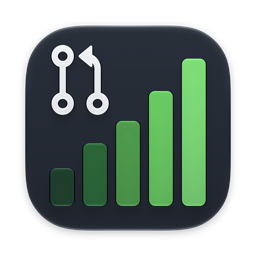

<p align="center">
  
</p>

<h1 align="center">PR Counter</h1>

<p align="center">A macOS menu bar app that shows how many GitHub pull requests you've opened.</p>

## Requirements

- macOS 15 or later
- Xcode, for `swift` and `actool`
- [GitHub CLI](https://cli.github.com) signed in with `gh auth login`

## Install

```sh
./build-app.sh
cp -R "build.noindex/PR Counter.app" /Applications/
open "/Applications/PR Counter.app"
```
